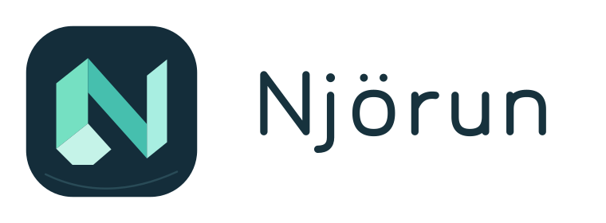

<div align="center">

<picture>
  <source media="(prefers-color-scheme: dark)" srcset="assets/brand/wordmark-dark.svg">
  <source media="(prefers-color-scheme: light)" srcset="assets/brand/wordmark-light.svg">
  
</picture>

**Your home. Within reach.**

A native Home Assistant touchscreen companion, built with Rust for ESP32-P4.

[](https://github.com/metaneutrons/njorun/actions/workflows/ci.yml)
[](LICENSE)
[](LICENSES/Apache-2.0.txt)

</div>

---

Njörun is a touchscreen companion for Home Assistant under development.
The repository contains a native Rust simulator, dashboard/application core,
and an experimental Home Assistant integration. End-to-end qualification is
in progress; no supported tablet firmware or product release is available.

The design targets a native Rust application on ESP32-P4, using ESP-IDF. The
Seeed reTerminal D1001 is the first hardware target; the Guition
JC1060P470C-I-W-Y is a later port. Planned capabilities include a native
touchscreen interface, a dedicated Home Assistant integration, and signed
firmware updates with automatic rollback.

## Project plan

The [embedded Home Assistant blueprint](docs/plans/001-embedded-ha-blueprint.md)
is the source of truth for scope, decisions, dependencies, and acceptance
criteria. Its linked epic and milestone issues record execution state and
evidence. [Repository standards](docs/repository-standards.md) describe the
current checks and deferred implementation gates.

## Host development

The [host implementation plan](docs/plans/002-host-vertical-slice.md) tracks simulator
enrollment, shared profiles, real HA controls and recovery. With Rust, uv and
Docker available, build the simulator and live UI probe, then run the disposable
HA scenario:

```sh
cargo build -p njorun-simulator --all-features --example live_ui --bin njorun-simulator --locked
uv run --locked python experiments/vertical-slice/qualify.py
```

The scenario creates its own temporary HA instance and does not use your
household installation. Enrollment, shared profiles, native HA configuration,
a real Slint light action, restart/reload recovery, peer rejection and revocation
pass locally. A clean combined run enforces at least 90% application line coverage.
The host scenario also passes on Linux CI. Physical tablet qualification remains open. For the standalone simulator without qualification
helpers, use `cargo build -p njorun-simulator --locked`.

The dashboard header shows the host’s active default network when identifiable
(Wi-Fi strength or Ethernet), HA connection status and local time. Tap the HA
icon to inspect the connection. A pulsing server icon indicates reconnection.

For a visual review, render the dashboard with fixture data. The 80 PNGs cover
rooms, favorites, mixed views, details, feedback, cached offline states, empty
favorites and binary sensors across the two display sizes, orientations and themes.

```sh
cargo run -p njorun-simulator --features qualification --example preview --locked -- target/card-review
```

The simulator is a native desktop executable on macOS and Linux. Linux uses
X11 or XWayland for an interactive window. To debug touch handling without HA,
run the native pointer test in a debug build:

```sh
cargo test -p njorun-simulator --features qualification --test native_interactions --locked
```

On macOS, open fresh portrait and landscape first-run fixtures with:

```bash
python3 scripts/run-first-start-demo.py
```

The fixture keeps Wi-Fi and browser approval deterministic for visual review.
Run the real discovery, PKCE browser login and HA-backed room dashboard with:

```bash
cargo run -p njorun-simulator --features qualification --example first_run --locked -- portrait target/first-run-live.json live
```

The live flow discovers `_home-assistant._tcp.local.` installations and retains
only non-secret setup progress in the state file. HA tokens are written to a
separate private credentials file next to it.

For interactive debugging with an enrolled simulator, build with `cargo build
-p njorun-simulator --locked` and launch `target/debug/njorun-simulator` under
LLDB or GDB. Pass `run --credentials FILE --state-dir DIR` using the provisioned
private credentials and a writable state directory. The disposable scenario
creates its own credentials and removes them on exit. The dashboard, display
policy and HA client run as ordinary host code. The P4 uses a separate target.

A separate [ESP32-P4 compile experiment](experiments/p4-build/README.md) has
produced byte-identical ELFs across two clean Linux builds with pinned Rust and
ESP-IDF inputs. See its [qualification evidence](experiments/p4-build/qualification.md).
It compiles and links a smoke program using the shared application core;
display, touch, networking and on-device
application behavior remain unqualified.

The [pairing protocol candidate](docs/protocols/001-pairing-bootstrap.md) tests
mutual authentication and encrypted messages with pre-established peer keys.
It does not implement first enrollment, USB transport or persistent device storage.
See [CONTRIBUTING](CONTRIBUTING.md) for reproducible checks and the
[reference evidence](docs/research/001-reference-evidence.md) for feasibility findings.

## License

Njörun is copyright © 2026 Fabian Schmieder. Project-owned Rust, Slint and
embedded firmware sources are licensed under GPL-3.0-or-later. The Home
Assistant integration in `custom_components/njorun` is licensed under
Apache-2.0. See the [license scope](LICENSES/README.md) and complete license
texts for details. Third-party files retain their own licenses.
