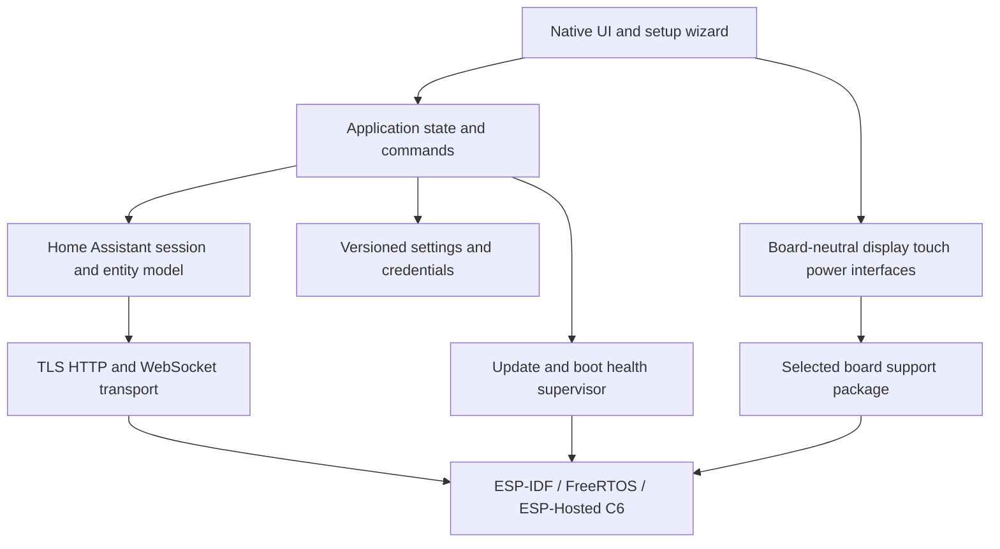

# Njörun — Embedded Home Assistant touchscreen blueprint

Decision state: platform, native UI, browser-assisted login, public repository
standards, dedicated HA integration and reviewed MVP scope accepted on 2026-11-03.
Project name: Njörun (ASCII identifier: `njorun`), selected on 2026-11-03.
Repository owner: `metaneutrons`. Technical qualification outcomes remain open.
This document is not an implementation claim.
Epic: [#1](https://github.com/metaneutrons/njorun/issues/1). Milestone issues are linked below.

## Product identity

- Display name: **Njörun**.
- ASCII spelling for repository, package prefixes and Home Assistant integration
  domain: `njorun`. Repository: [metaneutrons/njorun](https://github.com/metaneutrons/njorun).
- Description: A touchscreen companion for Home Assistant.
- The name supersedes Gná, Domiwall and all earlier naming candidates.
- Preliminary screening on 2026-11-03 found no exact DPMAregister match or
  obvious competing smart-home/software product. See the Nordic screening
  section below for scope, spelling variants, existing uses and limitations.
- `njorun.com`, `njorun.de` and `njorun.app` returned no registry record.
  Preferred primary domain: `njorun.com`; registration and pricing are unconfirmed.
- No domain has been purchased or trademark application submitted. Preliminary
  screening is not comprehensive trademark clearance.

### Historical Gná naming screening — 2026-11-03

Registry RDAP responses show `gna.com`, `gna.net`, `gna.de`, `gna.dev`,
`gna.app`, `gná.com` (`xn--gn-nia.com`) and `getgna.com` are registered.
The `.org` registry blocked the request (HTTP 403), so `gna.org` was not
verified by RDAP. Its historical software-hosting use is separately known.
No registration record was returned (HTTP 404) for `gná.de`
(`xn--gn-nia.de`), `gna-home.com`, `gna-home.de` or `gnapanel.com`.
No-record results are provisional: registrar purchase availability, restrictions
and prices have not been confirmed.

DPMAregister was searched directly with DE, EM and IR datasets enabled.
Both `gna` and `Gná` returned 20 results across all classes/statuses;
`gna` limited to classes 9 or 42 and registered/pending marks returned 9.
The accent did not distinguish the search results. Material findings:

- EU word mark **GNA 016297772**, GNA Biosolutions GmbH: shown as registered;
  classes 1, 5, 9, 10, 42. Class 9 includes broad computer software,
  electronic/control apparatus and computers; class 42 includes software
  maintenance, cloud computing and hardware/software development.
  https://register.dpma.de/DPMAregister/marke/registerHABM?AKZ=016297772
- EU word mark **GNA 018992027**, Christian Gaus: shown as registered;
  class 42 includes IT/software/hardware services expressly limited to
  architecture, real estate and technical planning.
  https://register.dpma.de/DPMAregister/marke/registerHABM?AKZ=018992027
- EU figurative mark **GNA 010602068**, G.N.A. S.R.L.: shown as registered;
  classes 7, 9, 37, focused on industrial machines and weighing machines.
  https://register.dpma.de/DPMAregister/marke/registerHABM?AKZ=010602068
- IR figurative mark **gna 1916900**, EDANA: EU protection requested;
  classes 35, 41, 42, 45, including specified event/training-management SaaS.
  https://register.dpma.de/DPMAregister/marke/registerIR?AKZ=1916900

This is a preliminary exact/word-component search, not comprehensive similarity
or worldwide clearance. DPMA's EU/IR data is not a substitute for checking
current legal status with EUIPO/WIPO. Actual use, goods similarity and the
legal significance of the accent remain unassessed. The broad GNA Biosolutions
word mark is a concrete issue to resolve before treating the brand as cleared;
an available compound domain does not resolve it. These findings contributed to replacing Gná with Njörun. The selected project name is Njörun.

## Outcome and baseline

Build a standalone Rust-based Home Assistant touchscreen client for ESP32-P4,
starting with Seeed reTerminal D1001 and designed from day one for multiple
boards, including Guition JC1060P470C-I-W-Y as a later qualification target. A person can commission the device, select
home controls, use them reliably, and install firmware updates that automatically
roll back if the new firmware cannot operate. No Linux, browser engine, or
mandatory project-operated cloud service runs the panel.

The project directory was empty. Vellum is a read-only engineering reference;
its source revision inspected was `f5075a36d6e477ef724ad0091c48999de655ea16`.
Its working-tree configuration describes 32 MiB flash, 32 MiB PSRAM, ESP-IDF
6.0, a C6 radio reached through ESP-Hosted/SDIO, and two 8 MiB OTA application
slots. These are reference settings, not measurements of this project's device.
Verify the actual board revision and capacities during bring-up.

## Product decisions and platform preference

Fabian confirmed a native dashboard and browser-assisted login on 2026-11-03.
Fabian selected Rust application code above the latest stable ESP-IDF.
ESP-IDF **v6.1** is the current stable release, verified against Espressif’s
GitHub latest-release endpoint on 2026-11-03. Pin the exact release/commit at
bootstrap; do not build against a floating `stable` branch. Qualify the Rust
bindings and managed components against that version. Report any incompatibility
rather than silently downgrading. Recheck the stable release at bootstrap time.

Accepted after design review:

- D1001 is the first supported device and first-release hardware gate. Guition is
  a later port; board separation and both resolution fixtures are required now.
- License: GPL-3.0-or-later for project-owned code. Review provenance before
  importing Vellum or vendor code; this decision does not relicense foreign code.
- Distribution: GitHub Releases with signed, board-specific OTA manifests and
  firmware artifacts. HA controls both manual and scheduled firmware installation.
- Local-network operation, normally externally powered. No battery-runtime or
  handheld-use requirement is implied by software portability.
- Permit local HTTP only through an explicit, clearly explained setup choice;
  HTTPS validates certificates normally. Private-CA provisioning is a later
  extension, not an additional first-release onboarding workflow. Never bypass
  certificate validation silently or automatically downgrade HTTPS to HTTP.
- Initial controls: lights, switches, scenes, sensors and binary sensors.
  Climate and covers follow later. No custom HA dashboard editor in the MVP.
- Automatically derive room views from HA areas; select favorites and ordering
  on the panel. Persist layout on-device and allow editing after setup.
- One repository and one UI framework, selected through focused Slint qualification.
  LVGL is a fallback decision, not a parallel implementation.

GitHub owner: `metaneutrons`. Exact
partitions, resource budgets, camera feasibility, toolchain compatibility and
supported HA versions are qualification tasks rather than bootstrap decisions.

## Accepted MVP scope

- One Home Assistant instance and one device session; local network operation.
- On-device Wi-Fi selection/password entry, instance discovery/manual URL,
  guided authentication, entity selection, and a completion check.
- Native favorites and room views, with light on/off/brightness, switches,
  scenes, read-only sensors and binary sensors. Climate and cover controls are
  deferred beyond the first release.
- Immediate visual touch feedback; pending, confirmed, failed, unavailable,
  and stale states are distinct. A command acknowledgement is not proof that
  a physical device reached its requested state.
- Settings for connection, brightness, sleep/wake, device information,
  reauthentication, and reset. Both portrait and landscape are required in the
  first qualified build, including setup, keyboard, QR and settings screens.
- Locally cached layout and last known values; stale values are labelled.
  No queued control actions replay automatically after reconnect.
- Signed application updates with two slots and automatic boot rollback.

Deferred: arbitrary Lovelace rendering, custom JavaScript cards, full companion
feature parity, multi-server accounts, history databases, video streaming,
Assist/wake word, camera streaming/recording, geolocation, cellular, Matter/Thread commissioning,
and mobile push-service infrastructure. They remain possible future work.

## Visual design and interaction

Use the Home Assistant iOS and Android companion apps as a reference for legibility,
visual hierarchy and touch feedback. Njörun has its own visual identity and navigation:
each panel opens its configured home view, where frequently used controls are
visible and operable directly.

Use one shared set of type sizes, spacing, corner radii and semantic colors across
commissioning, controls and settings. Use depth sparingly to distinguish layers.
Provide light and dark themes with clear labels, generous touch targets and visible
pressed, pending, failed and unavailable states. Color alone must not distinguish
those states. A tap gives immediate local feedback; confirmation waits for HA.
Keep scrolling smooth and transitions brief and interruptible. The same hierarchy
must work in portrait and landscape without shrinking a desktop or phone layout.

The factory theme mode is **Automatic**. Use Light during HA daytime and Dark
after sunset. Start in Light until the first valid day/night state is available.
If that state becomes unavailable, keep the last applied theme, including
across restart, then reconcile when HA supplies fresh state. The owner can set
**Automatic**, **Light** or **Dark** separately for each panel in HA. Persist
the selected mode. A fixed choice takes effect immediately and stays active
across day/night changes. A theme change while the backlight is off takes
effect on the next wake.

### Dashboard tiles

Choose the home view per panel in **Settings → Home screen**. Favorite selection
during setup is optional. Choosing favorites suggests **Favorites** as home.
Choosing **Skip** completes setup with **Room** as home and opens the list of
HA areas. Tapping an area opens its controls. In Room mode, an unset home area
means the panel starts at the room list. Browsing a room or adding a favorite
later preserves that preference. To start directly in a particular room,
select its area in Settings.

Use the room order of HA's built-in Home overview for the Rooms list and the
room shortcuts in Mixed. Follow its floor and area sequence, including areas
without a floor. Qualify the result against the frontend for each supported HA
version. The default works over the standard HA connection.

In HA, the Njörun integration offers **Room order** for each enrolled panel.
Choose **Follow Home Assistant** (default) or **Manual**, arrange the rooms and
save. Store the override by stable area ID. Append new rooms in HA order, skip
deleted rooms and preserve the position of renamed rooms. Returning to Follow
Home Assistant restores the current HA sequence. The panel applies the same
order to both views and caches it for reconnects. Configure manual room order
through HA. Favorite tile order has its own editor.

Populate rooms automatically from the lights, switches, scenes, sensors and
binary sensors the signed-in HA user can access. Omit entities HA marks hidden,
disabled or diagnostic. In the Njörun integration configuration in HA, the
owner can exclude additional entities from room views for an individual panel.
Clearing an exclusion restores the tile if it still meets the automatic rules.
Use the same filter for rooms reached from Mixed and for Unassigned.

Order eligible tiles within each room as they appear in HA's built-in Home area
view. Compare their relative order against the supported frontend version.
Append eligible entities without a corresponding HA tile in HA discovery order.
For Unassigned, apply the same placement rules to entities without an area.

In HA's Njörun configuration, choose **Follow Home Assistant** (default) or
**Manual** for tile order in a particular panel and room, including Unassigned.
Save the manual sequence by entity identity. Keep visible members in their
saved order and append newly eligible members in HA order. Apply visibility
and permission rules in both modes. Resetting a room to Follow Home Assistant
restores its current default sequence. Use the room's order from every entry
point, including Mixed. Room navigation and favorite ordering are independent.

Append **Unassigned** when at least one entity that passes these filters
has no effective HA area. Use the entity's area when set,
otherwise its device's area when available. Unassigned opens the same tile
view as a room. If HA has no areas, Unassigned can be the only entry. When
an entity gains an area, move it to that room and hide Unassigned as soon as
its last entity leaves. If both the room list and Unassigned are empty, show
setup guidance and a refresh action. Setup can still finish.

| Home view | Contents |
| --- | --- |
| Favorites | Ordered favorites and a Rooms button |
| Room | Room list, or controls for an explicitly configured home area |
| Mixed | Ordered favorites followed by room shortcuts |

Store the mode and selected area ID locally across restarts. Switching modes
preserves favorite selections and ordering. If the chosen area disappears,
offer another area or Favorites. Keep the saved area during a connection outage.
Use the responsive grid in every mode and orientation.

Home and room views use a stable grid. Keep favorites in user-defined order,
including when an entity goes offline. Preserve reading order across rotation.
Use the Pictogrammers Material Design Icons (MDI) family used by Home Assistant.
Home Assistant owns each entity's icon choice. All panels follow the configured
icon, including changes received during normal operation or after reconnect.
Icon customization takes place in HA. If the configured icon is absent or
unavailable on the panel, show an MDI fallback for the device class or domain.
Render glyphs at a consistent size and position. See
[Home Assistant icon conventions](https://www.home-assistant.io/docs/frontend/icons/).

Use two text lines in every dashboard view. The first shows the entity's display
name from Home Assistant and follows renames. Truncate a long name with an
ellipsis and show the full name in Details. The second shows the current state,
value with unit, or primary action. Examples include **On · 60%**, **21.4 °C**,
**Run scene** and **Unavailable**. Keep this line fully readable.

For M0 visual review, try a small read-only level bar alongside a known
percentage such as brightness. Give the text priority on narrow tiles. Show
offline or unavailable status explicitly and omit the bar when the level is
unknown. Leave out slider thumbs and extra touch targets so the whole tile
retains its primary tap and hold behavior. Give sensor
readings quieter styling. Keep setup sequential and settings in labeled rows.

| Entity | Tap the tile | Long press or visible details button |
| --- | --- | --- |
| Light or switch | Toggle once | Inspect state and adjust supported controls such as brightness |
| Scene | Run once and acknowledge HA's response | Inspect without activating |
| Sensor or binary sensor | Inspect the reading | Show reading, applicable unit and last update |
| Unavailable entity | Explain unavailability | Show available diagnostics and last known state |

Show command feedback on the tile's second line in the panel language.
For a light or switch, display **Turning on…** or **Turning off…** on sending
the request. Ignore additional primary taps on that entity while pending,
including taps from another view of the same entity. Show **On** or **Off**
when HA reports the resulting state. On explicit rejection, show a short
action-specific message such as **Couldn’t turn on** and give the reason in
Details. If confirmation times out, show **Unconfirmed** and refresh the state
from HA. Reconcile with fresh state without automatically retrying the action.
For a scene, briefly show **Requested** once HA accepts the command, then
restore **Run scene**. This acknowledges receipt of the request.

Highlight on touch-down. Commit the primary action on release inside the tile.
Scrolling, cancellation or leaving the tile cancels the tap. A recognized hold
opens details once and consumes the release. Give the visible details button
its own generous touch target and prevent its events from activating the tile.
Tune hold timing and movement tolerance on hardware. Consume the entire wake
gesture, including its release, before accepting input on the dashboard.

### Dashboard during a connection loss

Keep the current view and scroll position. Show one compact status banner
reading **Home Assistant offline · Reconnecting…** with a small, slowly
animated indicator beside the text. Keep the banner stationary and the tiles
still. Stop animating while the display is off. Room navigation and Details
remain available. Mark cached readings **Last known** and disable actions that
would send a command to HA. A single unavailable entity has its own tile state
and leaves the connection banner hidden.

After the connection returns, keep controls disabled during synchronization.
Clear the banner and restore eligible controls when fresh authoritative state
is ready. Provide the banner and stale-value labels in English and German.

### Editing favorites

Use **Add to favorites** in entity Details to append an entity to this panel's
favorites. On the Favorites screen, **Edit favorites** opens edit mode. Tapping
a tile selects it for editing. **Earlier** and **Later** move the selection one
place in reading order, including across rows. Disable the corresponding button
at the first or last position. **Remove** removes the selected favorite from
the panel. **Done** saves the edited list and returns to the dashboard.

The MVP uses buttons for reordering. Track drag handles separately in the
[post-MVP dashboard milestone](https://github.com/metaneutrons/njorun/issues/17).

### Entity Details presentation

Each panel remembers its own **Settings → Dashboard → Details presentation**
preference across restarts. Design and review **Adaptive sheet** first and use
it as the initial default. It opens beside the dashboard in landscape and from
the bottom in portrait. **Full screen** opens a dedicated view in either
orientation. Both presentations use the same entity details and controls.
The full HA name and current state are visible in both.

A long press and the visible details button open the selected presentation.
**Done** returns to the same dashboard view and scroll position. Tapping the
backdrop of a sheet dismisses it and consumes that tap. Opening or dismissing
Details must never trigger a control underneath.

## Commissioning UX and reusable keyboard

Confirmed direction, 2026-11-03: discover instances automatically and reuse a
framework-provided touchscreen keyboard rather than implementing a new keyboard.

Ship English and German for the MVP. On the first setup screen, show a visible
**English / Deutsch** choice with English initially selected. Apply the choice
immediately, before Wi-Fi or HA login, and persist it per panel across restarts.
Provide both languages for all Njörun UI text, including setup, dashboard
actions and state labels, settings, errors and idle screens.
Display room and entity names as supplied by HA. After enrollment, the owner
can change the panel language through HA over the existing settings connection.

On that first screen, select a scanned Wi-Fi network, enter its password if required, then
browse Home Assistant advertisements for `_home-assistant._tcp.local.` via
mDNS/Zeroconf. Display discovered instances by name with endpoint information to
distinguish duplicates. Let the user select one; do not silently pick the first.
Keep rescan and manual URL entry accessible while discovery runs. Discovery is
an address hint, not authentication or proof of identity. Verify the endpoint
and TLS identity under the configured trust policy before authentication.

After selection, show a QR link to standard Home Assistant browser authorization.
Do not ask for HA username/password on the panel or depend on a custom HA
integration for basic dashboard login. The local callback and redirect rules remain an M0 qualification
requirement. A displayed QR code is a link to authorization, not a claim that
Core supports a numeric device-code grant.

On later boots, reconnect to the saved instance and resume the existing session;
run discovery in the background for connection recovery. Do not repeat selection
or login on every boot. If discovery fails (including multicast isolation), show
clear retry/manual options; never erase saved credentials or silently switch
instances. Reauthentication occurs only when needed.

The two normal text-entry cases are Wi-Fi password and manual HA URL. Scanned
SSIDs and discovered HA names are selected from lists. Hidden-network SSID entry
is an optional advanced exception if supported; enterprise Wi-Fi credentials are
outside the current MVP.

For Slint, reuse its upstream `examples/virtual_keyboard` component and Rust
key-event wiring. This is an official reusable example, not a standard-widget
import or an OS keyboard. Preserve the source revision and notices when adopting
it; the inspected keyboard source is MIT-licensed. Adapt sizing and key maps,
not the input engine. If UI qualification selects LVGL instead, use its built-in
`lv_keyboard` attached to `lv_textarea`.

- Password: masked by default, explicit show/hide, letters/numbers/symbols,
  backspace and cursor movement; preserve exact input without autocorrection,
  capitalization, trimming or logging.
- URL: easy access to `.`, `/`, `:`, `-`, digits and IPv6 brackets; no
  autocorrection/capitalization. Show the effective scheme/address before connect.
- Keep the active field and inline error visible above the keyboard; use large
  touch targets and clearly labelled Connect/Cancel actions. Open on field focus
  and dismiss on completion/cancel; avoid desktop-style Tab/Esc clutter.
- Qualify symbol coverage (the upstream example is not a guarantee that every
  password character is reachable), long input, correction, focus transitions,
  and readable layout on the actual D1001.

Sources: [HA instance discovery](https://contributors.home-assistant.io/core/internals/instance-discovery/),
[Slint reusable keyboard](https://github.com/slint-ui/slint/tree/master/examples/virtual_keyboard),
[LVGL keyboard](https://lvgl.io/docs/open/8.2/widgets/extra/keyboard.html).

## Display orientation, idle behavior and remote settings

Confirmed requirements, 2026-11-03: portrait and landscape support; investigate
local camera motion detection for idle/screen wake behavior. HA-side settings
use a dedicated HA integration over the existing authenticated HA WebSocket.
MQTT and additional user-entered credentials are excluded.

Use responsive layouts at each supported board resolution, with explicit rotation and
matching touch-coordinate transforms. Offer four mounting rotations (0/90/180/270)
if the display backend qualifies them; portrait and landscape themselves are
mandatory. Automatic IMU rotation is a separate optional feature, not implied by
orientation support. Preserve an accessible local Display settings screen.

After automatic idle, wake to the last ordinary dashboard view at its previous
scroll position. For example, if the panel idles while showing Details for a
bedroom light, return to the underlying bedroom dashboard. If idle interrupts
setup or a favorites edit, resume that task with the in-progress input intact.
The configured home view applies at startup. Touch wake consumes the full first
gesture, including release.

With factory settings, turn the backlight off after five minutes of inactivity.
The owner can adjust the timeout per panel in Display settings or through the
HA integration. Persist the selected mode and timeout across restarts.

Initial state machine: active -> selected idle mode after one timeout. Idle mode
is either a dimmed clock screensaver or backlight off; disabled means no automatic
idle transition. Measure idle time since the last touch or qualified motion event.
Motion wakes idle-off/screensaver when enabled, but never overrides manual-off.
Manual-off is explicit and persists until touch wake or an explicit remote wake/on
command; changing brightness alone does not wake the panel. Consume the first
touch when waking so it cannot operate a home control. Configure active/idle
brightness, one idle timeout and wake sources; avoid a second sleep timer initially.
Camera feasibility is not a first-release gate; touch wake is mandatory.

Seeed documents an SC2356 MIPI camera and supplies camera-related ESP-IDF
components. This establishes a plausible integration path, not a working detector
in this project or Vellum. Qualify camera/display coexistence on IDF v6.1, memory,
thermal/power costs and low-light behavior before promising camera wake support.
Start with low-rate, downsampled luminance-frame differences, exposure-change
suppression, sensitivity, debounce and a hold interval. This detects image motion,
not reliable human presence; a stationary person may still time out. Avoid claiming
person detection. Touch wake and optionally an existing HA presence sensor remain
available when camera detection is disabled or unreliable.

Process camera frames locally and discard them; no image upload or recording is
required. Camera use is explicitly enabled in settings and can be stopped locally.
Backlight-off is not deep sleep: the processor/camera must remain active for this
wake source. Test light switching, changing display brightness, shadows, empty-room
false triggers, darkness and a stationary user; prevent self-induced wake loops.

### Native HA integration over the existing connection

Accepted on 2026-11-03: ship a dedicated Python Home Assistant integration alongside
Rust firmware. Initially distribute it as a HACS custom repository; HACS default
listing and eventual Core inclusion are separate submissions, not promises.
Standard HA authentication and local settings/basic dashboard controls must remain
usable without the integration. The panel detects its absence and explains how to
install it. Do not require notification scripts or manually created helpers for
ordinary device configuration.

The integration registers versioned, project-namespaced WebSocket commands and
subscriptions on HA's existing authenticated connection. The panel initiates the
connection; HA does not require an inbound panel HTTP API for management. The
browser-login callback remains a separate onboarding concern. No MQTT broker,
additional account, user-entered device password or external push service is used.

Protocol responsibilities:

- Panel announces stable device identity, firmware/protocol versions and a bounded
  capability set. A persisted identity survives firmware upgrades; reset/re-pair
  behavior must not accidentally take over another device's registration.
- Register a config flow/config entry and native device/entity registry records.
  An authenticated announcement may propose enrollment, but it cannot silently
  claim an existing device. Require administrator approval for first enrollment;
  bind enrollment to the authenticated session and device-held proof, not merely
  a claimed ID or shared HA username. Generate any internal credential automatically;
  no extra credentials are entered by the user. Validate every subsequent command.
  Present login and enrollment as one guided setup, explaining any administrator
  approval separately. Define replacement, factory reset and proof revocation in
  the protocol specification before implementation. Device IDs are not credentials.
- Expose an outbound command subscription on the same WebSocket. HA entity
  operations enqueue bounded requests with IDs and expiry. The panel validates,
  applies and acknowledges each request with actual resulting state or an error.
- Use explicit allowlisted capabilities and value ranges, request deduplication,
  timeouts and protocol-version negotiation. Reject unauthorized cross-device
  access, unknown operations, malformed payloads and unsupported versions.
- Device-reported state is authoritative. Publish state only after acknowledgement
  or fresh telemetry; a successful socket send is not a successful settings change.
- On disconnect mark entities unavailable; on reconnect resubscribe and request a
  full snapshot before normal updates. Do not replay stale wake commands or claim
  offline settings were applied. Preserve local operation and persisted settings.
- Persist validated settings atomically with debounced flash writes. Local and
  remote settings use one code path. Concurrent commands carry a settings revision
  so stale updates can be rejected/resynchronized rather than overwrite newer ones.
- Unloading/removing a config entry cancels subscriptions and pending operations.
  Revoked HA authorization prevents reconnection. Document logout, removal and
  factory-reset semantics without implying removal automatically revokes unrelated
  HA sessions. Re-enrollment requires explicit authorization.

HA device controls:

| Capability | Native entity | Behavior |
| --- | --- | --- |
| Backlight power and brightness | light | Actual applied brightness and on/off state |
| Orientation | select | Only qualified rotations offered |
| Screensaver mode | select | Supported modes, including disabled |
| Theme mode | select | Automatic (default), Light or Dark, persisted per panel |
| Panel language | select | English or Deutsch, applied immediately and persisted per panel |
| Idle timeout and idle brightness | number | Validated bounds and units |
| Camera motion wake | switch | Present only when supported; respects local camera disable |
| Motion sensitivity | number | Present only when detector is supported |
| Wake now | button | Transient command, never replayed after reconnect |
| Motion | binary_sensor | Motion semantics, not human-presence claims |
| Display mode and diagnostics | sensor | Actual state and detector health |

Use configuration/diagnostic entity categories where appropriate, stable unique
IDs and device association. The integration presents standard HA controls and
supports normal dashboards/automations; no custom frontend card is required.
Expose a firmware update entity per enrolled panel for installed and available
versions, release information, manual installation and reported progress.
Configure scheduling in the Njörun integration in HA. See the
[HA update entity contract](https://contributors.home-assistant.io/core/entities/update/).

Repository boundary: Rust firmware/core/UI plus a Python integration package and
independent HA tests. Keep the integration in `custom_components/<chosen_domain>/`
and share a versioned protocol specification and compatibility fixtures with the
firmware. Domain and release packaging are settled during repository bootstrap.
Use one repository. HACS requires all integration runtime files inside its single
`custom_components/<domain>/` directory; firmware and other project files may live
alongside it. Validate the actual package and installation before claiming support.
Add integration-specific CI and qualification to the strict gitrepo baseline.

Sources: [HA WebSocket extensions](https://contributors.home-assistant.io/frontend/extending/websocket-api/),
[Select entities](https://contributors.home-assistant.io/core/entities/select/),
[Number entities](https://contributors.home-assistant.io/core/entities/number/),
[Seeed D1001 hardware](https://wiki.seeedstudio.com/getting_started_with_reterminal_d1001/).

## Architecture

Rust owns application state, entity semantics, setup, UI presentation, protocol
logic, persistence policy, and update policy. ESP-IDF supplies FreeRTOS,
peripheral drivers, networking, TLS, and OTA services. Isolate unsafe FFI and its
buffer/lifetime/thread contracts in the platform layer. The bootloader and C6
radio firmware remain vendor components; no bare-metal HAL port is planned.

Use a Cargo workspace with `app-core`, `ha-client`, `ui`, `platform-esp32`,
`firmware`, and `simulator` boundaries. Keep the core independent of ESP-IDF so
the same state transitions and presentation models run in a desktop simulator.
Start with few crates; split only along these real dependency boundaries.

UI candidate: Slint compiled UI with its Rust software renderer and a shared
ESP-IDF renderer backend using board-provided display surfaces. Qualify rendering, input, memory use, integration, and license
terms before adopting it. LVGL behind Rust bindings is the fallback with the
strongest local Vellum precedent; it increases C dependency and binding work.
Do not select either solely from desktop screenshots.

### Multi-board portability: required from the first implementation

Accepted on 2026-11-03. D1001 is the first bring-up target, not the application
architecture. The second target is specifically **JC1060P470C-I-W-Y**, normalized
as a board identifier only after confirming the hardware revision. Do not equate
similarly named JC1060P470 variants or silently substitute their pin maps.

| Target | Evidence baseline | Qualification status |
| --- | --- | --- |
| Seeed reTerminal D1001 | Vellum: JD9365, native 800 x 1280, 32 MiB flash/PSRAM, C6 SDIO; camera candidate | Reference implementation only; no new firmware qualified |
| Guition JC1060P470C-I-W-Y | Manufacturer specification: JD9165, 1024 x 600, 16 MB flash, 32 MB PSRAM, capacitive-touch SKU | Planned target; exact revision, touch/radio wiring and peripheral inventory unverified |

The AliExpress listing could not be read during research. The manufacturer PDF
uses slightly inconsistent model text, so verify the board label, schematic and
revision before selecting panel init tables. Treat its capacity values as vendor
specifications until measured. Do not assume a camera or any other optional
peripheral exists merely because both boards use ESP32-P4.

Boundaries and ownership:

- `app-core`, `ha-client`, UI models and the HA integration contain no GPIOs,
  panel-controller initialization, fixed framebuffer dimensions, board names in
  behavior branches, or ESP-IDF-specific types. UI layout uses runtime dimensions
  and capabilities. Device metadata may display model names without branching.
- A shared ESP-IDF platform layer owns task/transport/storage/OTA mechanisms and
  renderer integration. Reusable drivers own controller behavior. Board support
  packages own wiring, bus allocation, power/reset sequencing, panel timings/init,
  touch transforms, backlight polarity/PWM, network setup and hardware revision
  constraints. Sharing a controller does not imply sharing a panel init table.
- Start with `boards/reterminal-d1001/` and
  `boards/guition-jc1060p470c-i-w-y/` profiles, each with canonical metadata,
  sdkconfig inputs, partition layout, component pins and qualification notes.
  Keep unverified values explicitly unset; a release build must reject incomplete
  profiles. Do not fabricate a buildable second target from unverified pins.
- Define narrow contracts for display surfaces/presentation, touch events,
  backlight, network readiness, clock/storage/update operations and optional
  camera/power sensors. Make DMA/cache alignment and buffer ownership explicit.
  Choose a board at build time; expose dimensions and capabilities at runtime.
  Reject missing or multiple board selections. No risky GPIO-probing autodetection.
- A capability descriptor is the shared source for local settings visibility and
  the versioned HA capability announcement. It includes supported rotations,
  dimensions, brightness range, camera/motion, battery and other actual features.
  Advertise only implemented and initialized capabilities. Missing features are
  omitted, transient failures become unavailable; do not create fake readings or
  permanently remove user entities for temporary driver failures.
- Camera motion is optional per board; touch wake and idle/screensaver behavior
  are mandatory. Network capability determines whether onboarding offers Wi-Fi,
  an already-working wired connection, or both. Do not make Wi-Fi password entry
  mandatory on a future wired board.

Both portrait and landscape layouts must work at 800 x 1280 / 1280 x 800 and
1024 x 600 / 600 x 1024 in the simulator from the first UI milestone. Reflow
controls, keyboard and QR sizing; do not scale a fixed D1001 canvas. Use physical
size/density metadata where trustworthy to preserve practical touch target sizes.
Memory budgets are per board and include DMA-capable internal RAM, PSRAM and
flash; avoid making 32 MiB flash an application requirement.

Build/release one firmware artifact per board and incompatible hardware revision,
with a common application version. Bind board ID, supported revisions, partition
layout ID and coprocessor compatibility into signed update metadata. Validate
against the installed board identity and immutable update constraints before
writing/selecting an image. Never infer the board from display dimensions or a
filename. Partition tables and minimum app slot size are per board; two 8 MiB
slots cannot fit into the Guition's stated 16 MB flash with system partitions.
Derive its slot sizing from measured release images and required headroom; no
final offsets or slot sizes are selected yet.

A board port should add a profile/BSP and reuse drivers without editing HA
semantics or core UI. Cross-board tests must prove that boundary. CI builds every
qualified board for shared firmware/platform changes and only affected boards
for isolated BSP changes, with conservative handling of unknown dependencies.
Keep simulated, compile-checked and hardware-qualified support distinct in the
support matrix. No board is advertised as supported solely because it compiles.

Manufacturer reference:
[Guition JC1060P470C-I-W-Y specification](https://www.guition.com/hr/icms/upload/fb081940d6fc11f09850077a33e1404f/FTPData/UEditor/file/2026121/1768961093646/JC1060P470C_I_W_Y%20Specifications-EN.pdf).

### Platform qualification

Verify the actual P4 revision, PSRAM/flash capacity, display timing and C6 firmware
before configuring the board. Vellum contains no implemented touchscreen driver;
identify the touch controller and qualify its reset, interrupt and input path.
Pin a compatible Rust toolchain, esp-rs bindings, IDF and managed-component set.
Prove display scanout remains correct during flash writes. Inspect installed C6
firmware and preserve its recovery path before any radio reflash; do not apply
Embassy-specific packet-mode requirements to the ESP-IDF transport.

One task owns UI mutation. Network callbacks deliver bounded messages; they do
not draw or block on rendering. Coalesce rapid entity updates and slider commands.
Keep display DMA/cache requirements separate from ordinary PSRAM allocation.
Do not assume that every buffer can live in PSRAM or that two CPU cores imply
free concurrency.

## Home Assistant contract

Use the official authenticated WebSocket API for live state and commands, with
HTTP for authentication and endpoints that require it. Maintain request IDs,
timeouts, heartbeat, reconnect backoff with jitter, and an explicit session state.
After reconnect, rebuild authoritative state and subscriptions; handle the
snapshot/event ordering race rather than applying an old snapshot over new data.

Resolve selected entities and areas through version-tested APIs. Bound incoming
frame sizes, parsing memory, entity count, attribute storage, and event queues.
Large installations must degrade with an actionable limit message, not a crash.
Select subscription/filtering strategy in the protocol spike; do not assume a
full `get_states` response fits in a fixed RAM budget.

The dedicated integration provides native panel management and telemetry over
its versioned WebSocket extension. Basic dashboard control uses standard HA APIs
and remains independent of it. mobile_app registration is not required for the
selected management architecture; revisit only for a specific future Companion
feature. Never impersonate the official iOS/Android app identity.

Authentication design is a gating spike. Prefer a browser authorization-code
flow with a project client identity, validated redirect, unpredictable state,
PKCE where supported by the qualified HA version, and token exchange on the
device. Prove how the callback reaches the physical device securely; a QR code
alone does not solve callback routing or credential delivery. Test local hostnames,
IP addresses, HTTPS, MFA, token expiry, revocation, and interrupted pairing.
Do not assume HA offers an OAuth device-code grant. Do not collect HA passwords
through an improvised native password form. An explicitly chosen long-lived
token import could support development, but is not equivalent to consumer login.

Verify HTTPS certificates by default. Explicitly selected local HTTP is supported
with a clear explanation that traffic is unencrypted. Private-CA provisioning is
deferred; invalid/untrusted certificates produce an actionable error, never an
automatic validation bypass or HTTP downgrade. Establish time before TLS
checks and provide recovery from invalid device time without a TLS bypass.

Persist refresh credentials with the platform's protected storage configuration;
redact neither partial tokens nor token-bearing URLs into logs—omit them entirely.
Device reset removes local credentials and attempts revocation when connected;
offline reset explains how to revoke the remaining server-side session. A local
screen lock protects casual access but is not a Home Assistant authorization scope.

## Update and recovery contract

HA owns firmware release discovery, policy, initiation and user feedback. The
touchscreen has no update badge, menu, prompt, progress or result screen.
In HA choose one of two installation policies per panel:

- **Manual only** installs a compatible update when the owner selects Install
  in HA. Discovery alone can never trigger installation.
- **Automatic at a configured time** lets HA initiate an available compatible
  update at the owner's chosen time of day in HA's configured time zone.

Offer **Stable** and **Beta** firmware channels from the first release.
Select the channel per panel in HA, independently of the installation mode
and time. Start new panels on Stable. Both manual and scheduled installs
use the selected channel. Changing channel refreshes the eligible candidate.
It does not itself start installation or authorize a downgrade.

Publish stable versions from protected `main` through release-please. Each
merge to protected `develop` runs CI. Beta publication requires a separate
manual promotion by a maintainer who selects the exact commit SHA. Before
publishing a uniquely versioned GitHub prerelease, verify that the selected
commit belongs to `develop`, its required CI passed and its board qualification
evidence matches the candidate. Use that SHA throughout promotion even if the
branch advances. Bind the channel, board and exact
source revision into signed release metadata. Verify the selected channel
before installation. Stable discovery excludes beta and staged candidates.
Beta discovery admits only explicitly published beta candidates, including
when a stable candidate is temporarily staged as a GitHub prerelease.
Apply signing, compatibility checks and boot rollback to both channels.

On first enrollment, default to **Automatic at 02:00** each day in HA's
configured time zone. The owner can change the time or select Manual only
in HA. Preserve those choices across reconnects and restarts. If HA or the
panel is offline at the scheduled time, skip that occurrence. On reconnect,
wait for the next scheduled time before starting an automatic install.
The owner can still select **Install** in HA before then.

Both paths use the same authorized, expiring
install command over the enrolled panel's existing connection. Bind it to the
panel and candidate, deduplicate requests and allow one install at a time.
The panel independently verifies the signed candidate and performs the OTA.
Report progress, rejection, reboot and rollback to HA. After reconnect, use the
running version and confirmed boot result to reconcile the outcome. Without
the integration the basic dashboard works and no HA-managed OTA starts.

Two application slots mean `ota_0` and `ota_1`, plus boot metadata, NVS and other
system data. They do not mean only two physical flash partitions.
For D1001 only, use Vellum's two 8 MiB slots as a sizing candidate within
its 32 MiB layout. Other boards require their own capacity-qualified layouts.
Finalize offsets only after measuring firmware/assets and allocating persistent
data and diagnostic space. Initial USB provisioning installs the partition table;
normal application OTA must not modify the bootloader or partition layout.

Bundle fonts/icons/UI assets with each application image initially so they roll
back with the executable. Avoid shared mutable asset bundles in the MVP.
Initial engineering target: at least 20% slot headroom; confirm the final budget
from measured artifacts before release qualification.

1. On an authorized HA install command, fetch a bounded signed board-specific manifest from GitHub Releases over
   verified HTTPS. Check product/board,
   image size, hash, version, compatibility constraints, and signing key.
2. Stream only into the inactive slot; retain the active image on interruption.
   Verify artifact signature and digest before selecting the next boot image.
3. Boot into pending verification with rollback enabled in the ESP-IDF bootloader.
   With an ESP-IDF application, explicitly configure application-controlled
   confirmation where the selected version exposes that option; automatic startup
   confirmation would defeat our health gate.
4. A bounded supervisor checks storage, display/input initialization, UI progress,
   memory/critical task health, and C6 host-link initialization. A watchdog forces
   recovery from hangs; explicit fatal failure requests rollback.
5. Mark the image valid only after the agreed local health interval. Wi-Fi AP,
   internet, or Home Assistant outages alone must not trigger rollback loops.
6. Persist/report the failed candidate and reason; do not auto-retry the same
   failed image indefinitely. Expose recovery and USB reflash instructions.

Proposed health interval: 60 seconds, calibrated during qualification. Automatic
boot rollback covers the unconfirmed boot window; faults appearing after
confirmation need a separate recovery policy and are not automatically covered.

Settings are shared across slots. Use atomic, versioned records and migrations
readable by the previous supported image, or staged copies retained until the
rollback window is closed. Test firmware downgrade with real saved state.
Factory reset must not erase boot metadata or strand both application slots.

The ESP32-C6 is a separate firmware participant. Pin its compatible firmware
and hosted-protocol versions. MVP P4 OTA does not update the C6. Both P4 slots
must work with the installed C6 version; reject an update that cannot satisfy
this contract. Future coordinated C6 updates require their own recovery design.

The HA integration must remain compatible with the previous qualified firmware
protocol so a failed firmware upgrade can roll back after the integration has been
updated. Test integration upgrade followed by firmware rollback. Shared release
versions do not imply simultaneous installation. Version the protocol explicitly
and publish the supported pairs; incompatible updates must explain prerequisites.

Firmware authenticity, secure boot, flash encryption, and anti-rollback are
distinct controls. Signed OTA and boot rollback are first-release requirements.
Irreversible secure-boot/eFuse provisioning is a separate production decision,
not a default action of development or first-install flashing. Define a development and production security profile; qualify
key provisioning and recovery before irreversible eFuse changes. Do not advance
an anti-rollback floor in a way that makes the required fallback image unbootable.

## Delivery and acceptance

Each milestone's evidence
must identify the exact source, toolchain, board revision and firmware artifacts.

### M0: Architecture qualification

Execution: [#2](https://github.com/metaneutrons/njorun/issues/2).

Sequence: prove the standard HA QR authorization/callback flow first, then qualify
the Rust/ESP-IDF build and one UI framework before substantial dashboard work.
A local client-ID/callback origin is a candidate allowed by current HA source,
not yet an end-to-end demonstration. Test real phone browsers and the supported
HTTP/HTTPS modes; no manual HA-token copying may be required.

Dependencies: accepted ESP-IDF platform and native UI/browser-assisted setup.

- M0-A0: Verify the latest stable IDF release at bootstrap and pin it. Read the
  actual P4 revision and select matching IDF settings. Demonstrate Rust-binding
  compatibility with the pinned IDF before building the application framework.
- M0-A1: Rust firmware builds reproducibly, boots on the D1001, drives display
  and touch, connects through the C6, and performs verified HTTPS and WebSocket
  exchange. Record exact pins/versions and actual memory capacities.
- M0-A2: UI candidate renders representative scrolling tiles and a keyboard at
  native resolution while network traffic runs. Record frame times, touch latency,
  peak internal RAM/PSRAM use, and binary size. Set final budgets from evidence.
- M0-A4: Establish board-neutral contracts and both capability/resolution fixtures
  before product UI implementation. Record the second target's intended identity and
  document unknowns without blocking D1001 on physical Guition availability; reject incomplete board profiles and ambiguous selections.
- M0-A3: Demonstrate an end-to-end login/callback/token-refresh design against
  a named HA version, including rejection of an invalid pairing callback.

- M0-A5: Before production dashboard implementation, obtain maintainer approval
  of a versioned visual reference covering the adaptive Details sheet in both
  orientations, favorites/room controls, QR login,
  password keyboard, display settings and a recoverable error. Review both themes
  and orientations, including the compact Guition simulator fixture. On the D1001,
  demonstrate a representative interactive slice with scrolling and touch feedback;
  record photos or video, measurements from M0-A2, revisions and the review decision.
  Mockups alone cannot qualify the renderer or the physical touch experience.

- M0-A6: On D1001, ask a person unfamiliar with the gestures to turn on a
  hallway light, dim it and inspect a scene without running it. Record whether
  names and states were readable at the intended distance, whether details
  were discoverable without coaching and which HA actions were actually sent.
  Resolve accidental activation or an undiscoverable control before approval.

### M1: Product shell and commissioning

Execution: [#3](https://github.com/metaneutrons/njorun/issues/3).

Dependencies: M0.

- M1-A1: From erased application settings, a user completes Wi-Fi, instance,
  login and either selects favorites or skips that step. Verify that Skip opens
  the room list and that restarting returns to it. Setup requires no file edits.
  Verify the default home view and that a later Settings change survives restart.
  Run first boot in English and Deutsch, switch before connecting, then restart
  and verify the selected language survives. Review both languages in portrait
  and landscape for clipped controls and untranslated labels.
- M1-A2: Wrong Wi-Fi password, absent discovery, expired login and interrupted
  setup have recoverable screens; restart preserves completed setup atomically.
- M1-A4: Verify multiple discovered instances, zero results, multicast blocked,
  manual URL entry and returning-user reconnect. Reuse the upstream keyboard;
  demonstrate exact password entry including symbols and editing a long URL.
- M1-A5: Qualify portrait and landscape across every screen, including keyboard
  and QR readability, touch mapping and persistence after restart. Verify idle
  transitions, first-touch wake consumption and local recovery without HA.
  Wake from the screensaver and backlight-off modes after navigating away from
  home. Verify the prior room and scroll position, dismissal of ordinary Details,
  and preservation of interrupted setup and favorite edits.
- M1-A6: Record camera motion feasibility with simultaneous display/network use,
  lighting changes, dark-room limitations and measured resource use. If feasible,
  qualify local motion wake and disable behavior; if not, report the blocker and
  retain touch wake. This investigation does not block first release; no camera
  capability is claimed without device evidence.
- M1-A3: Simulator covers wizard/navigation states; device validates keyboard,
  touch edges, brightness and wake behavior. Credential/log review passes.

- M1-A7: Compare the implemented shell, commissioning and settings screens with
  the approved M0 reference. Capture both simulator resolutions in portrait and
  landscape and exercise light/dark themes on D1001. Check text and control
  legibility at the intended viewing distance, touch accuracy, keyboard focus,
  error recovery and responsiveness during transitions. Record discrepancies,
  resolve them or obtain approval for a revised reference before M2 dashboard work.

### M2: Reliable native controls

Execution: [#4](https://github.com/metaneutrons/njorun/issues/4).

Dependencies: M1.

- M2-A1: Each in-scope domain displays correct state and units and issues only
  supported actions. Permission denial and unavailable entities are visible.
- M2-A2: Disconnect/reconnect and HA restart recover to current state without
  replaying old actions or overwriting new events with stale snapshots. Exercise
  offline room browsing, stale labels and the reconnect indicator on D1001.
  Verify controls stay disabled until sync completes and that loss of a single
  entity leaves the panel-wide banner hidden.
- M2-A3: Proposed qualification fixture: 1,000 total HA entities, 100 selected,
  and 20 incoming updates/second. No unbounded memory growth or queue growth.
  Target local touch feedback p95 <=100 ms and active interaction >=30 fps;
  these are proposed targets, not measured claims or HA service-latency promises.

- M2-A4: Verify that each deliberate primary tap sends exactly the expected
  command. Inspecting details, scrolling, cancelling, waking the panel and
  tapping an unavailable entity send no control command. Exercise both routes
  into details on D1001 and verify tile order through state changes and rotation.
- M2-A5: Switch between Favorites, Room and Mixed in both orientations. Verify
  the default room order against HA Home in Rooms and Mixed, the room list
  with no pinned area, navigation into an area, Unassigned appearing last or alone and disappearing
  after its final entity gains an area, the empty-area
  state, favorite order and recovery when HA removes the selected area.

- M2-A6: Exercise both Details presentations in portrait and landscape using
  both entry gestures. Switch the setting, restart and verify the selection.
  Check return position and confirm that backdrop dismissal sends no HA command.

- M2-A7: Add a favorite from Details, select it in the editor, move it across
  a row boundary with the buttons and remove a favorite. Verify endpoint button
  behavior, the saved order after restart in either orientation, and zero HA
  control commands during editing.

- M2-A8: Open a room with ordinary controls and sensors alongside hidden,
  disabled, diagnostic and inaccessible entities. Verify automatic contents
  with the integration absent and apply the same eligibility rules to Unassigned.

- M2-A9: Compare eligible room tiles with the built-in HA area view on a
  named frontend version. Verify the sequence through Rooms, Mixed and rotation,
  and exercise the corresponding placement rules in Unassigned.

- M2-A10: Delay state confirmation and tap twice. Verify one command, visible
  pending feedback and final state from HA. Exercise explicit rejection with
  the reason in Details, timeout followed by a state refresh without a retry,
  and scene acceptance followed by restoration of the normal action label.
  Review the inline messages in English and German.

### M2H: Native Home Assistant device management

Execution: [#5](https://github.com/metaneutrons/njorun/issues/5).

Dependencies: M0 authenticated transport and M1 local settings model. Deliver in
parallel with M2 controls after those dependencies are qualified.

- M2H-A1: Install the integration from a clean supported HA environment, enroll
  the panel with administrator approval and create native entities grouped under
  one device. No MQTT, manually configured helpers or extra entered credentials.
- M2H-A2: Exercise each exposed control in the standard HA UI; confirm actual
  applied state, persistence and matching local settings. Test invalid values,
  stale revisions, failed application and timeout without optimistic false success.
- M2H-A3: Test reconnect snapshots, HA restart, unload/reload, removal, revoked
  tokens, duplicate commands and device identities, and unauthorized cross-device
  access. A disconnected panel is unavailable; stale wake commands are not replayed.
- M2H-A4: Validate supported firmware/integration protocol pairs and unsupported
  versions. Confirm that absent integration leaves basic dashboard/local settings
  operational. Document the tested HA version range and HACS installation path.

- M2H-A5: Configure a manual room order for one of two panels in HA and verify
  the other follows HA. Check Rooms and Mixed after reconnect, area rename,
  addition and deletion, and restoration of the default. Unassigned remains
  last whenever populated.

- M2H-A6: In HA, exclude a room tile on one of two panels. Verify the choice
  survives reconnect, the second panel still shows the tile, and clearing the
  exclusion restores eligible tiles. Exercise hiding the final Unassigned tile.

- M2H-A7: Set a manual entity sequence in one room on one panel through HA.
  Verify isolation across rooms and panels, persistence after reconnect, new
  and excluded entities, and reset to the current HA order.

### M3: Qualified OTA and recovery

Execution: [#6](https://github.com/metaneutrons/njorun/issues/6).

Dependencies: M1. Device experiments can begin during M0. End-to-end OTA
qualification requires the authenticated management connection from M2H.

- M3-A1: Valid signed update succeeds; corrupted, unsigned, wrong-board and
  oversized candidates are rejected while the existing application remains usable.
- M3-A2: Inject power loss during download, slot writing and boot selection;
  crash/hang the pending image. Device recovers to a usable image and reports it.
- M3-A3: Confirm rollback preserves usable settings and compatible assets/C6
  firmware. Test with HA unavailable and Wi-Fi absent to avoid false rollback.
- M3-A4: Display remains usable during flash writes; physical USB recovery from
  an unusable application is demonstrated and documented.

- M3-A5: Verify a newly enrolled panel defaults to Automatic at 02:00 HA local
  time and owner changes persist. From HA, install manually and exercise the automatic policy at a
  configured time. Verify manual-only mode never initiates a scheduled install.
  With an update available, take HA and the panel offline in separate runs at
  the scheduled time. Verify reconnect starts zero installs and the next
  scheduled occurrence starts one if the update is still eligible.
  Check concurrent triggers, restart/reconnect, confirmed success and rollback
  reporting in HA, and absence of update UI on the D1001.

- M3-A6: Check manual and scheduled OTA against each selected channel. Reject
  a candidate from the wrong channel and verify changing a panel back to Stable
  cannot silently downgrade its installed firmware.

### M3B: Later second-board port and portability qualification

Execution: [#7](https://github.com/metaneutrons/njorun/issues/7).

Dependencies: M0 interfaces and verified Guition schematic/revision/hardware;
M1, M2 and M3 for full functional qualification. Profile/driver work may proceed
before application completion without claiming hardware support.

- M3B-A1: Build and boot the exact JC1060P470C-I-W-Y revision using a separate BSP
  without board-specific logic added to app-core, ha-client or common UI models.
  Verify flash/PSRAM, panel/touch, backlight and networking from physical evidence.
- M3B-A2: Qualify onboarding, both orientations, keyboard/QR, dashboard, local
  settings and native HA controls at its resolution. Absent camera/battery
  capabilities create neither unusable settings nor false HA entities.
- M3B-A3: Qualify two-slot signed OTA/rollback within the measured flash capacity,
  including settings compatibility and recovery. Reject D1001 images on Guition
  and Guition images on D1001 before boot selection, even with valid signatures.
- M3B-A4: Record each board's memory, render/input performance, artifact size,
  slot headroom and pin/component provenance. Publish support status per exact
  revision; document any unqualified hardware explicitly.

### M4: MVP qualification and release readiness

Execution: [#8](https://github.com/metaneutrons/njorun/issues/8).

Dependencies: M2, M2H and M3 on D1001. M3B is a later delivery, not a first-release
gate. The first release must still demonstrate board separation and both
resolution fixtures; Guition remains labelled planned until hardware-qualified.

- M4-A1: On D1001, run a device soak (initial engineering target: 72 hours)
  with reconnects, HA restarts, interactions,
  sleep/wake and update checks; no crashes or sustained memory growth.
- M4-A2: Validate clean installation and upgrade from the previous qualified
  version; document supported HA versions, feature limits and recovery.
- M4-A3: Produce reproducible build instructions, pinned dependencies, dependency
  license inventory, SBOM, signed firmware/manifest and artifact checksums.
  Verify signatures with both valid and deliberately altered artifacts.

- M4-A4: Verify the stable release-please path and the develop beta path
  against exact revisions. Verify that a green develop merge alone publishes
  nothing and that manual promotion rejects an unqualified SHA. Verify the
  prerelease identifies the selected SHA when develop advances. Inspect both published feeds and demonstrate that
  staged stable assets and beta assets are isolated from unintended consumers.

First-release completion means M0, M1 (except conditional camera feasibility),
M2, M2H, M3 and M4 have the required evidence. M3B has separate later acceptance.
Proposed performance/soak/headroom targets must be calibrated and recorded before
qualification; changing them requires an explicit design decision, not silent waiver.
Firmware publication requires the acceptance evidence defined above.
GitHub planning records exist; their creation is not product acceptance.

## Risks and development discipline

The major risks are board integration, native UI performance at full resolution,
secure browser-to-device pairing, bounded parsing of large HA installations,
and compatibility across rollback. A 1280 x 800 RGB565 framebuffer occupies
2,048,000 bytes; two consume about 3.91 MiB before widgets, fonts, network buffers,
TLS, stacks, and caches. Capacity alone does not establish scanout bandwidth.

Use host unit/protocol/state-machine tests and the simulator for normal iteration;
use hardware for timing, power, flash interruption, and peripheral behavior.
No native build matrix for documentation-only changes. Pin build inputs and
commit lockfiles when scaffolding begins. No time or cost estimate is established.

Vellum source carries AGPL-3.0-or-later notices, including the board code.
Record the intended reuse/license basis before importing it.
Vellum is a reference, not an automatic dependency. Preserve component provenance
and check licenses before copying code. Do not copy its credentials, signing
keys, product identity, cloud backend, or unrelated application logic.

## Evidence and references

Local Vellum references (outside this repository):

- `firmware/sdkconfig.defaults.p4`: memory, radio SDIO mapping, cache/PSRAM
  handling during OTA, watchdog and rollback configuration.
- `firmware/partitions.d1001.csv`: two 8 MiB slots and factory-flash requirement
  for partition layout changes.
- `firmware/components-lcd/d1001_board/`: board initialization and power behavior.
- `README.md`: D1001 capabilities and ESP-IDF build baseline.

Official references consulted on 2026-11-03:

- [Seeed D1001 product](https://www.seeedstudio.com/reTerminal-D1001-p-6729.html)
- [Home Assistant Companion documentation](https://companion.home-assistant.io/)
- [iOS source reference](https://github.com/home-assistant/iOS)
- [Android source reference](https://github.com/home-assistant/android)
- [HA authentication](https://contributors.home-assistant.io/core/internals/auth-api/)
- [HA WebSocket protocol](https://contributors.home-assistant.io/core/internals/websocket-api/)
- [HA mobile app registration](https://contributors.home-assistant.io/companion/mobile-app-api/setup/)
- [ESP-IDF P4 OTA](https://docs.espressif.com/projects/esp-idf/en/stable/esp32p4/api-reference/system/ota.html)
- [esp-rs ESP-IDF](https://github.com/esp-rs/esp-idf)
- [esp-hal device support](https://github.com/esp-rs/esp-hal)
- [Slint embedded platforms](https://docs.slint.dev/latest/docs/slint/guide/platforms/embedded/)

## Public repository standard

Fabian requires strict application of the gitrepo skill for public GitHub
repositories. Use its **hardened** profile because this application will ship
firmware binaries to users. This blueprint records the requirements; repository
bootstrap is limited to the planning stage described in [repository standards](../repository-standards.md).

- Repository owner: `metaneutrons`; original project, no imported Vellum code. Product name: Njörun;
  repository and integration identifier: `njorun`.
  The selected project license is GPL-3.0-or-later and the publication channel is
  GitHub Releases. Preserve the skill's provenance rules and establish the
  ownership/license basis before importing any Vellum code.
- Apply the prescribed skeleton/community files, unanchored ignores, Conventional
  Commits, hooks, squash-only integration, active branch/tag rulesets, security
  features, Dependabot and SHA-pinned Actions. No AI attribution trailers.
- Pin Rust and ESP-IDF toolchains; commit lockfiles. Keep unsafe code confined to
  justified platform crates. Run formatting, Clippy, nextest, coverage with a
  hard floor, and cargo-deny where applicable to the host/embedded split.
- Keep a stable required CI aggregate; require a check only after it has actually
  run. Use component-sensitive qualification and cheap documentation-only checks.
  Test embedded cross-builds separately from host-executable core tests.
- Use release-please, signed artifacts, GitHub attestations, SBOMs, clean-room
  smoke qualification, staged releases and verified published bytes. Firmware
  signature verification on-device is distinct from distribution attestations.
- Keep publication credentials in protected release environments. No release
  error suppression. Use the skill's audit script and read back settings before
  claiming conformity. Document any genuinely necessary embedded adaptation;
  never silently weaken a required guarantee.
- Track substantial implementation with the versioned plan and authorized epic/
  milestone issues. Execution state belongs in the linked issues.

## Decision changes

2026-11-03: Review recommendations accepted. D1001 first release; Guition later;
GPL-3.0-or-later; GitHub Releases; local-network/external-power baseline; explicit
local HTTP choice and normal HTTPS validation; fixed initial entity domains;
on-panel layout configuration; simplified idle states; session-bound enrollment;
HA-integration compatibility across firmware rollback. One repository/framework.
Prior two-board first-release requirement is superseded.

2026-11-03: Multi-board portability accepted from day one. Add Guition
JC1060P470C-I-W-Y as the second qualification target, board-specific BSPs and
OTA layouts, responsive resolution fixtures and capability-driven UI/HA entities.

2026-11-03: Native UI and browser-assisted login confirmed. After ecosystem
assessment, Fabian selected the latest stable ESP-IDF beneath Rust and required
strict public-repository gitrepo standards. ESP-IDF v6.1 verified as current.
The no_std-first proposal is superseded. No implementation or hardware
qualification yet.

2026-11-03: Dedicated HA integration accepted for native device controls over the
existing authenticated WebSocket. Supersedes MQTT and mobile_app command/script
configuration proposals. No extra user-entered credentials; standard dashboard
operation remains available without the integration.

[Verified ESP-IDF stable release](https://github.com/espressif/esp-idf/releases/tag/v6.1)

Further references:

- [HACS integration packaging](https://www.hacs.xyz/docs/publish/integration/)
- [HA redirect validation implementation](https://github.com/home-assistant/core/blob/dev/homeassistant/components/auth/indieauth.py)

Superseded no_std research is recorded in the conversation history; it is not a
normative dependency or platform-selection task for this ESP-IDF project.

## Screened Nordic naming alternatives — 2026-11-03

Njörun was selected following this screening; Ljósvík remains an unused alternative.

- **Njörun / Njorun**: registry RDAP returned HTTP 404 for `njorun.com`,
  `njorun.de` and `njorun.app`. DPMAregister `njorun` returned no matches
  across DE/EM/IR, all classes and statuses. Expanded query `n?orun?`
  returned 14 results; the close spelling NIORUN (EU 018330980) is shown
  withdrawn and concerns sporting clothing, bags, bottles and retail.
  Broader results included unrelated longer names, not an exact Njorun mark.
  Web searches found an artist and company names, but no obvious competing
  smart-home/software product. These uses prevent a claim of global uniqueness.
- **Ljósvík / Ljosvik**: registry RDAP returned HTTP 404 for `ljosvik.com`,
  `ljosvik.de` and `ljosvik.app`. DPMAregister `ljosvik` returned no matches
  across DE/EM/IR, all classes and statuses. Expanded query `lj?s?v?k?`
  returned two unrelated multiword marks (Luiten and LJUS KLASSIK LAGER).
  Web searches found Icelandic geographic/street uses and dictionary material,
  but no obvious competing smart-home/software product.

Domains are apparently unregistered, not registrar-confirmed purchasable.
No pricing, reserved/premium status or purchase was established. Trademark
screening is preliminary and not a comprehensive phonetic/similarity or
worldwide clearance. EU/IR records were read through DPMAregister; current
status has not been independently verified at EUIPO/WIPO.

Sources:
- https://register.dpma.de/DPMAregister/marke/basis
- https://register.dpma.de/DPMAregister/marke/registerHABM?AKZ=018330980
- https://rdap.verisign.com/com/v1/domain/njorun.com
- https://rdap.verisign.com/com/v1/domain/ljosvik.com
- https://rdap.denic.de/domain/njorun.de
- https://rdap.denic.de/domain/ljosvik.de
- https://www.helsinki.fi/assets/drupal/2022-12/rmn_08_2014.pdf
